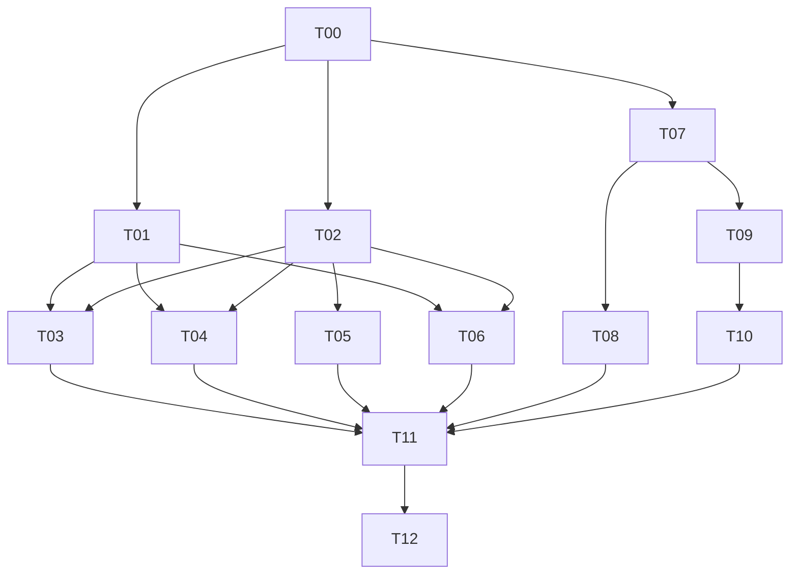

# Kế hoạch tác vụ — Giai đoạn 2

**Goal:** Hoàn thiện bot và trải nghiệm single-player từ mã hiện có, giữ deterministic lockstep và tương thích multiplayer.

**Architecture:** Planner bot tách module, observation có giới hạn, arbiter ngân sách/pending dùng chung; room mode và pause do server quản lý, UI đi qua controller phiên.

**Tech stack:** TypeScript, npm workspaces, Node >=24, PixiJS/Vite, Vitest, Playwright.

**Spec/context:** [CONTEXT.md](CONTEXT.md). **Verification contract:** [TEST_MATRIX.md](TEST_MATRIX.md).

Đây là kế hoạch để triển khai sau, không phải chỉ thị bắt đầu code trong lần tạo tài liệu. Tất cả ID dưới đây ở trạng thái **TODO**.

## Quy tắc chia việc

- Orchestrator chốt commit nền và contracts T00 trước khi giao module. Đọc và cập nhật bảng trạng thái dưới đây khi thực hiện.
- Một file chỉ có một writer trong cùng thời điểm. Các agent làm module mới và test riêng; integrator sở hữu `ai-bot.ts`, test tích hợp bot, barrel exports và các nối API chung.
- T07 sở hữu protocol/session/rooms trong wave nền tảng. T09 rồi T10 sửa tiếp các file chung này **tuần tự**, không sửa song song.
- Mỗi task: đọc mã → test tái hiện thất bại đúng nguyên nhân → thay đổi tối thiểu → test xanh → review → tích hợp. Không tạo test chỉ khớp implementation.
- Khi một yêu cầu đã có code/test tốt, giữ lại và chứng minh bằng test thay vì viết lại. Thực hiện phần thiếu và các edge case của task.
- Dùng worktree/branch riêng nếu môi trường hỗ trợ và đã được phép; không tự reset/clean/rebase phá thay đổi của người khác. Không tự commit/push/deploy nếu ngoài phạm vi được giao.

## Đồ thị phụ thuộc

## T00 — Kiểm kê, contracts và profile độ khó

- **Owner:** orchestrator/architect. **Phụ thuộc:** không.
- **Đọc:** bot, bot tests, lobby/session, sim techs, protocol; CONTEXT.
- **Tạo:** `apps/client/src/bot/types.ts`, `difficulty.ts`, `difficulty.test.ts`; bảng API trong tài liệu triển khai.
- **Hợp đồng:** `BotDifficulty`, `BotProfile`, observation DTO, `BotIntent`, budget/resource claims, `PlannerInput`, planner state, seed, game-time/turn và callback xuất lệnh. Cấu hình mode/setup nằm trong protocol chỉ sau T07.
- [ ] Chạy baseline test hiện có, ghi fail/skip và commit nguồn; không coi kết quả kiểm tra ngày trước là baseline.
- [ ] Viết test ba profile được parse/validate, tham số có giới hạn, cùng input không phụ thuộc wall clock; giữ semantics profile Medium gần hành vi cũ trừ lỗi đã xác nhận.
- [ ] Chốt version contracts và mẫu input/output đủ để module agent viết test độc lập. Không phát minh cost/tech ID mới.
- **Done:** agent downstream biết chính xác import/API, không còn tự đặt schema trùng nhau.

## T01 — Observation, fog of war và reachability

- **Owner:** agent perception. **Phụ thuộc:** T00.
- **Tạo:** `bot/observation.ts`, `observation.test.ts`.
- **Hợp đồng:** snapshot thông tin được biết + truy vấn `canReach(actor, target, range)` theo master/passability của actor; không xuất danh sách enemy toàn bản đồ.
- [ ] Tái hiện đảo tách biệt, resource đen, động vật đã mất tầm nhìn, building đã khám phá nhưng khuất và mục tiêu đổi chủ/chết.
- [ ] Tận dụng `zones.of(master(...))`, `withinRange` và visibility hiện có; zone chỉ là precheck, không bảo đảm vượt được vật cản động.
- [ ] Phân biệt remembered static object với mobile target phải đang thấy; xử lý zone label wrap bằng API hiện có, không so nhãn như định danh toàn cục.
- **Done:** planner không nhận dữ liệu trái phép và không dùng zone dân để kết luận cho tàu hoặc mọi loại quân.

## T02 — Budget, reservations và chống command trùng

- **Owner:** agent scheduler. **Phụ thuộc:** T00.
- **Tạo:** `bot/budget.ts`, `budget.test.ts`.
- **Hợp đồng:** arbiter nhận intents và resource/unit/building claims, trả accepted/rejected cùng key/reason; pending có lifecycle issued/applied/failed/expired. Planner propose không commit state của command; outcome accepted mới cho phép commit phase/cooldown/pending liên quan.
- [ ] Test hai planner cùng chi gỗ/vàng, hai lệnh vào cùng building, cùng dân bị build+work, pending qua `COMMAND_DELAY_TURNS`.
- [ ] Tính ngân sách toàn tick một lần; giữ chỗ cho lệnh đang chờ; không reserve kép khi pending đã thành foundation/queue/research thật.
- [ ] Giải phóng pending khi lệnh thất bại, actor chết, mục tiêu mất, building bị phá; TTL không giải phóng sớm tạo spam.
- [ ] Test intent build/attack bị reject không tạo pending hoặc chuyển phase/cooldown; tick sau retry ổn định, và accepted chỉ commit đúng một lần.
- **Done:** resource không bị chi trùng, không starvation vô hạn, không vượt giới hạn batch protocol.

## T03 — Kinh tế bền vững, Farm và săn bắt

- **Owner:** agent economy. **Phụ thuộc:** T01, T02.
- **Tạo:** `bot/economy.ts`, `economy.test.ts`.
- **Giữ code tốt:** Market/Farm/voi/vàng/đá/đánh cá hiện có; xác định phần cần chuyển module và phần cần sửa.
- [ ] Test nguồn quả/hươu cạn dẫn đến Farm; Farm cạn nhiều lần vẫn được thay/tái canh đúng cơ chế sim; Farm cạn không ngăn đạt số ruộng sản xuất mục tiêu.
- [ ] Test mỏ cạn, kho không tới được, thiếu gỗ/vàng, số dân thấp; ưu tiên phục hồi kinh tế trước quân đắt tiền.
- [ ] Săn voi có lực lượng phù hợp, hủy/đổi mục tiêu khi không an toàn; tránh săn nhầm voi trên đảo khác.
- **Done:** kịch bản nhiều chu kỳ thực phẩm vẫn sản xuất được; không tạo lệnh/ruộng trùng trong thời gian chờ.

## T04 — Chuỗi công trình và lên đời

- **Owner:** agent progression. **Phụ thuộc:** T01, T02.
- **Tạo:** `bot/progression.ts`, `progression.test.ts`.
- [ ] Test Market khi Tool Age; Government Center/Temple/Siege Workshop/Academy theo chiến lược và master enabled; pop-cap, base chật, builder chết.
- [ ] Dùng availability của tech làm nguồn sự thật cho Bronze/Iron, không tự suy điều kiện chỉ từ số công trình.
- [ ] Phân biệt pending, foundation, active, destroyed; không coi pending building đã mở điều kiện lên đời.
- [ ] Tách mục tiêu “đủ điều kiện lên đời” với mục tiêu “đủ công trình cho đội hình”, tránh dừng vĩnh viễn sau hai công trình.
- **Done:** lên Iron với setup hợp lệ; khi civ/đời chưa cho phép, không lặp research/build bất hợp lệ.

## T05 — Công nghệ, nâng cấp và chọn quân

- **Owner:** agent technology. **Phụ thuộc:** T00, T02.
- **Tạo:** `bot/research-planner.ts`, `research-planner.test.ts`.
- [ ] Đối chiếu PRIORITY_TECHS với `TECHS`, tech state và location, master sau upgrade, civ tree.
- [ ] Test Clubman/Axeman, nhánh kiếm, Improved/Composite Bowman và nhánh quân khác riêng biệt; không dựa tên Việt để nối cây.
- [ ] Không research ở building đang train/queue/research; nhiều building không cùng research một tech; giữ ngân sách kinh tế/lên đời theo ưu tiên đã chốt.
- [ ] Test tech unavailable/disabled/done, upgrade làm ID master đích giữ nguyên nhưng record thay đổi; không huấn luyện bản yếu do chỉ nhìn ID nguồn.
- **Done:** công nghệ có mục đích, hợp lệ theo civ và không khóa kinh tế hoặc quá trình lên đời.

## T06 — Squad/Wave có trạng thái

- **Owner:** agent tactics. **Phụ thuộc:** T00, T01, T02.
- **Tạo:** `bot/squads.ts`, `squads.test.ts`.
- **Hợp đồng:** mỗi squad có ID, member IDs, role, target, phase, thời điểm lệnh; state đề xuất `forming/rallying/attacking/retreating/recovering`.
- [ ] Test quân mới sinh không kéo toàn quân về rally; member chết/mất quyền sở hữu bị loại; một unit không thuộc hai squad.
- [ ] Chỉ đổi lệnh khi phase/target đổi, target invalid hoặc quá hạn stuck; không phát lại attack theo mỗi nhịp think.
- [ ] Defense có thể preempt attack theo ưu tiên, giữ unit đang đánh hợp lệ; regroup/retreat không dựa thông tin enemy bị che.
- [ ] Quân khác passability chia nhóm hợp lý; target unreachable không gây lặp attack vô hạn.
- **Done:** trace nhiều tick cho thấy lifecycle squad và command churn có giới hạn, không chỉ đổi tên danh sách military.

## T07 — Room mode và quyền điều khiển single-player

- **Owner:** agent protocol/server. **Phụ thuộc:** T00. Chỉ một writer cho protocol trong wave này.
- **Sửa:** `protocol/messages.ts`, `codec.ts`, `server/rooms.ts`, `lobby/session.ts` và test tương ứng.
- [ ] Thêm room mode mặc định multiplayer; truyền mode authoritative qua lobby/start/rejoin. API create cũ tiếp tục hoạt động.
- [ ] Thiết kế cách host cấp quyền vào slot bot có xác thực; không cho khách đặt tên Computer để hưởng quyền bot/single-player.
- [ ] Validate civ/map/size/difficulty ở boundary phù hợp; giữ room settings khóa khi ready/started.
- [ ] Test multiplayer không dùng được quyền pause/speed mở rộng; mode tồn tại đúng qua reconnect; lỗi tạo/join không để room nửa chừng.
- **Done:** UI và bot nhận mode/profile ổn định; có bảng schema và compatibility note cho T08–T10.

## T08 — Setup chơi đơn và lifecycle

- **Owner:** agent single-player UI. **Phụ thuộc:** T00, T07.
- **Tạo:** `lobby/single-player-setup.ts`, `lobby/single-player-controller.ts`, test riêng; `e2e/tests/single-player-setup.spec.ts`.
- **Sửa có khóa writer:** `lobby-view.ts`; thay chữ ký `AiBot.spawn` chỉ qua integrator để giữ API cũ.
- **Phối hợp bắt buộc:** trong chính T08, integrator cung cấp bridge tối thiểu cho options setup/profile/civ vào constructor/spawn/start, trên các file do integrator sở hữu. Không đợi tới T11 mới tạo bridge này. T08 nghiệm thu đường truyền cấu hình và state khởi tạo; kiểm chứng khác biệt chiến thuật đầy đủ giữa profile thuộc T11.
- [ ] Màn hình có civ người/máy (cả Random), map/size từ danh sách sim, Easy/Medium/Hard, Start/Cancel và validation/error/loading.
- [ ] Apply settings/civ trước ready/start; chờ server xác nhận, không dùng sleep 300 ms làm bảo đảm đồng bộ.
- [ ] Click nhiều lần chỉ tạo một phiên; cancel/rời phòng/spawn thất bại/retry/hủy view đều hủy bot và timer; promise muộn không hồi sinh phiên cũ.
- [ ] Profile được truyền tới config bot thực, không chỉ đổi nhãn; không start khi form đang chỉnh hoặc bot chưa sẵn sàng. T11 phải chứng minh config được các planner/scheduler sử dụng thành hành vi khác biệt.
- **Done:** cả hai world bắt đầu cùng seed/settings/civ; multiplayer lobby giữ hành vi cũ, focus/keyboard cơ bản dùng được.

## T09 — Pause/F3 đồng bộ

- **Owner:** agent session-control. **Phụ thuộc:** T07; phối hợp T08, tích hợp UI ở T11.
- **Tạo:** `lockstep/pause-control.ts`, test riêng; `e2e/tests/single-player-pause.spec.ts`.
- **Sửa có khóa:** rooms/protocol/link/lockstep, HUD keyboard/options; không chạy đồng thời T10 trên cùng file.
- [ ] Viết design nhỏ và test fake relay trước: authoritative pause epoch + boundary, xử lý turn/batch đã gửi/đã release; hai peer dừng tại cùng boundary.
- [ ] Giữ control channel, ping/pong và resume hoạt động khi simulation dừng. Không xếp resume vào command queue đang không chạy.
- [ ] Test pause trước/sau command release, ngay startup, lặp F3, game over, disconnect/rejoin khi paused; stale/duplicate message không đổi state sai.
- [ ] Reset deadline/accumulator khi resume, không chạy bù toàn bộ thời gian pause; bot không tiếp tục sản xuất command hoặc làm relay báo stall vì pause.
- **Done:** worldTime/turn/checksum ở boundary đứng yên trên cả hai peer; resume tiếp tục đồng bộ, multiplayer bị chặn quyền single-player.

## T10 — Tốc độ single-player và lỗi tăng tốc kép

- **Owner:** agent session-control hoặc successor. **Phụ thuộc:** T07, T09; sở hữu cùng file tuần tự.
- **Sửa:** `lockstep.ts`, sim `commands.ts`, protocol/server validation, HUD options và tests; `e2e/tests/single-player-speed.spec.ts`.
- [ ] Tái hiện `gameSpeed²` bằng fake clock. Để World nhân gameSpeed đúng một lần; paceScale chỉ phụ thuộc debug speed nếu thiết kế hiện tại vẫn như context.
- [ ] Tốc độ hữu hạn có giới hạn theo CONTEXT; whitelist multiplayer cũ được kiểm tra trên server, không chỉ trên radio buttons.
- [ ] Test đổi tốc độ lúc đang pause, command áp dụng tại boundary, resume không burst; bot cũng nhận thay đổi qua luồng đồng bộ, không chỉ human.
- [ ] Kiểm tra cả gameTime/baseTime và pacing theo fake clock. Không mặc định baseline 1x bằng đúng 1 giây game/giây thực trong mô hình turn hiện có.
- **Done:** tỷ lệ so baseline đúng một lần, debug speed còn hoạt động, multiplayer/replay không hồi quy.

## T11 — Nối module và kiểm thử tích hợp

- **Owner:** integrator. **Phụ thuộc:** T03–T06, T08–T10.
- **Sở hữu:** `ai-bot.ts`, `ai-bot.test.ts`, barrel exports, `multiplayer.ts`, `e2e/globals.d.ts`, bridge UI/bot/session chung.
- [ ] Duy trì `AiBot.step(world): Command[]` và đường network; thay đổi constructor/spawn bằng options tương thích caller cũ.
- [ ] Nối observation → planners → arbiter → commands; thử nghiệm state nhiều tick qua `World.addBatch`, không bỏ qua command delay.
- [ ] Nối difficulty từ setup vào bot, squad state theo phiên, pause/speed cho cả hai peer; cleanup xóa toàn bộ state/reservation.
- [ ] Chạy regression gốc, test tích hợp command traces, seeded game human+bot và multiplayer hai người.
- **Done:** không còn module đã viết nhưng không được gọi; test chứng minh user flow đi tới hành vi thực.

## T12 — Nghiệm thu và tài liệu

- **Owner:** QA/reviewer độc lập. **Phụ thuộc:** T11.
- **Sở hữu:** test tổng hợp mới `e2e/tests/single-player-progression.spec.ts`, tài liệu; không sửa logic để làm test pass mà không trao đổi với owner.
- [ ] Thực hiện TEST_MATRIX, `npm run check`, `npm run build`, E2E liên quan, determinism và soak theo phạm vi đã chốt.
- [ ] Kiểm tra ảnh thật nếu có pack hoàn chỉnh; ghi rõ nếu chỉ dùng synthetic pack. Không coi asset lỗi là bot logic đã fail hoặc ngược lại.
- [ ] Review API, deadlock pause, cheats/mode spoofing, lifecycle và non-regression multiplayer.
- **Done:** báo cáo đủ pass/fail/skip, seed, command, artifact/log và giới hạn; chỉ đóng task sau khi lỗi mức cao được sửa và retest.

## Waves đề xuất với tối đa 3 implementer + 1 orchestrator

| Wave | Công việc | Quy tắc tích hợp |
|---|---|---|
| A | T00 | Chốt contract trước |
| B | T01 + T02 + T07 | Module/file tách biệt |
| C | T03 + T04 + T05 | Chung contracts, không sửa ai-bot entry |
| D | T06 + T08 | T08 giữ riêng lobby-view; integrator nối spawn |
| E | T09 rồi T10 | Protocol/rooms/lockstep tuần tự |
| F | T11 rồi T12 | Merge, review và E2E độc quyền port |

Module có thể viết test song song bằng fixture chung đã chốt, nhưng không tự tạo nhiều bản contracts khác nhau. Reviewer đọc diff so với baseline của đúng task, không chỉ đọc lời tóm tắt của implementer.

## Bảng trạng thái khi bắt đầu triển khai

| Task | Owner | Status | Base commit | Branch/worktree | Test evidence | Review |
|---|---|---|---|---|---|---|
| T00–T12 | Chưa phân công | TODO | Chưa ghi | Chưa tạo | Chưa chạy | Chưa review |

Tách thành 13 dòng khi dispatch. Trạng thái chỉ dùng TODO / IN_PROGRESS / IN_REVIEW / DONE / BLOCKED; ghi nguyên nhân và việc có thể tiếp tục nếu blocked.
